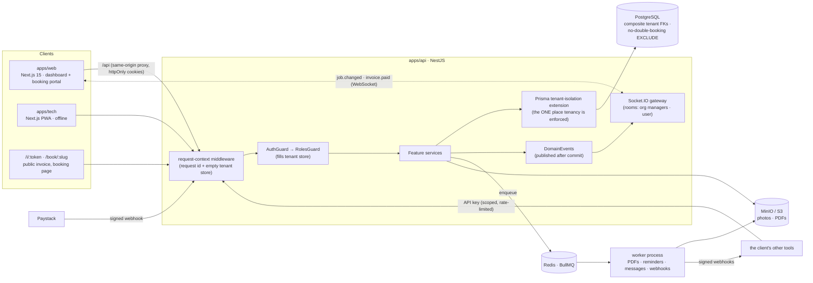

# OpsDesk

> **Status:** all 8 phases complete: operations (customers, jobs, a live dispatch board), an offline-capable technician app, inventory, quotes, invoices and online payment, a public booking page with customer notifications, owner analytics, and a public API with webhooks, packaged as a **white-label template** with one-command client deployment.

OpsDesk is a **white-label operations app for small service businesses** (plumbers, cleaners, HVAC, generator repair). It covers the whole loop: a customer books, the job is scheduled, a technician is dispatched, the work is completed with photos and a signature, an invoice is sent and payment is received.

**Each deployment serves one business.** Its name, branding, regional settings and modules come from one typed file, [`config/client.config.ts`](config/client.config.ts), plus env overrides, all validated with Zod. Optional modules (inventory, payments, booking portal, technician app, analytics, public API) switch on or off per client. A new client goes from blank VPS to live HTTPS instance with nightly backups via [`scripts/deploy-client.sh`](scripts/deploy-client.sh); see **[Deploying a client](docs/deploying-a-client.md)**.

**Try it:** run it locally in five commands (below) and use the one-click demo sign-in buttons on `/login`. A public demo deployment is the same stack with `DEMO_LOGINS=true` and `--seed-demo` (see the [deploy guide](docs/deploying-a-client.md)).

**What a day looks like in it:** a customer books on the client's own site (`/` → `/book/<slug>`); it lands in the dispatcher's "to schedule" tray, live; they drag it onto a technician; the customer gets a confirmation; the technician works it from the PWA (offline if need be: photos, parts, a signature); the office invoices it in one click; the customer pays from the link; the owner sees it in analytics. That whole path is one Playwright test.

## Architecture



```
apps/
  api/        NestJS REST + WebSocket API + background worker (auth, RBAC, tenancy, jobs, dispatch, billing, payments)
  web/        Next.js dashboard (dispatch, jobs, quotes, invoices…) + the public invoice/pay page
  tech/       Technician PWA at /tech: offline queue, photos, signature, parts (`technicianApp`)
packages/
  config/     Client-config schema, env overrides, feature list (@opsdesk/config)
  db/         Prisma schema, migrations, bootstrap, demo seed, tenant-isolation extension
  shared/     Zod schemas + constants shared by API and frontends
  ui/         Design system shared by web + tech: tokens, components, motion, illustrations
config/       THIS deployment's client.config.ts (the local demo client: "Brightline")
clients/      Per-client folders (config + .env); only clients/example is committed
infra/
  docker/     API and web images (client config compiled in)
  deploy/     Production compose stack, Caddyfile, backup job
scripts/      deploy-client.sh, backup-now.sh, restore.sh
docs/         Operator guides
```

## Tech stack

pnpm workspaces + Turborepo · Next.js 15, Tailwind CSS v4, shadcn/ui conventions, Motion, Sonner, Lucide · NestJS 11 · PostgreSQL 16 + Prisma 6 · Redis + BullMQ · Zod 4 · Vitest + Supertest + Playwright · Docker Compose · GitHub Actions.

## Key decisions & trade-offs

**White-label: one business per deployment, configured as code.**

- _Config is code, validated twice._ [`client.config.ts`](config/client.config.ts) is typed (`defineClientConfig` gives autocomplete) and checked by a Zod schema ([schema.ts](packages/config/src/schema.ts)): real IANA time zones, real ISO currencies, hex colours, bare hostnames, and a payment provider whenever payments are on. It's validated when the client's image is **built** (a typo fails the build, not production) and again at **boot**, after env overrides. `pnpm client:check <name>` runs the same check locally.
- _Explicit overrides._ A fixed table of `CLIENT_*` variables, plus `FEATURE_<NAME>=true|false`, overrides the file ([resolve.ts](packages/config/src/resolve.ts)). There's no generic deep-merge, so it's always clear what an env var can change, and a bad value names its source. Secrets never go in the config file. The web app reads config per request, so overrides apply on restart without a rebuild.
- _Disabled features don't exist._ `AppModule.forRoot(config)` only imports enabled feature modules ([feature-modules.ts](apps/api/src/features/feature-modules.ts)), so their routes 404 and their providers never start. Endpoints that sit inside a core module use `@RequireFeature()`, a guard that runs **before** authentication, so a disabled feature looks identical to a missing route for everyone. In the web app, nav items declare their feature and disappear when it's off.
- _No public signup._ `bootstrap` creates **the** organization and its owner from config ([bootstrap.ts](packages/db/src/bootstrap.ts)). It's idempotent: re-running it after a config change syncs name, colour, currency and time zone, and audits what changed. It never touches an existing owner's password, and it refuses to touch a database that belongs to a different business. Everyone else joins by invitation.
- _Why keep the multi-tenant layer?_ Each database now holds one business, but the row-level isolation below stays as defence in depth, and it costs nothing at runtime. The tests still create many orgs per database to prove isolation. It also keeps a hosted multi-business version one config switch away instead of a rewrite.

**Deployment: one stack per client, one origin per stack.** Each client gets its own server, project, volumes and secrets ([docker-compose.yml](infra/deploy/docker-compose.yml)).

- _Caddy_ terminates TLS with automatic Let's Encrypt certificates and serves the app, `/api` and `/socket.io` from **one origin**. That keeps auth cookies first-party and needs no CORS.
- _Uploads_ use a separate `files.` hostname that only ever serves presigned URLs.
- _Internal services:_ Postgres, Redis and MinIO are never exposed to the internet.
- [`deploy-client.sh`](scripts/deploy-client.sh) runs every step in order: generate missing secrets (never overwriting existing ones) → check DNS → build → migrate → bootstrap → start and wait for health. It shows the owner's initial password once, then removes it from `.env`.
- _Backups:_ a nightly job writes atomic `pg_dump` files and mirrors uploaded files through the S3 API, with retention and an optional off-site S3 copy. `restore.sh` takes a safety backup before replacing anything.
- _CI:_ the scripts are ShellChecked, the compose file is rendered with the example client, and every image is built on each push.

**Row-level multi-tenancy, enforced in one place.** Every tenant-owned table has `organizationId`. A Prisma client extension ([tenant-extension.ts](packages/db/src/tenant-extension.ts)) adds the current tenant to every query's `where` and to every `create`. It also rejects attempts to move a row to another tenant. The current tenant comes from an `AsyncLocalStorage` store that the auth guard fills in once per request ([tenant-context.ts](packages/db/src/tenant-context.ts)), so services never write `organizationId` filters themselves.

- _Fail-closed:_ a tenant-scoped query with no tenant in context throws instead of returning every tenant's rows.
- _Automatic coverage:_ the list of scoped models is derived from the schema (any model with `organizationId`), so a new model can't be forgotten.
- _Defence in depth:_ relations between tenant tables use **composite foreign keys** `(id, organizationId)`. Postgres itself rejects, for example, a job in tenant A that points at tenant B's customer.
- _Escape hatch is explicit:_ `prisma.unscoped` exists only for pre-auth flows (login, invite acceptance). An ESLint rule blocks it everywhere else.
- _Why not schema-per-tenant?_ Thousands of small tenants would mean thousands of schemas to migrate, and connection pooling gets harder. Row-level tenancy with one schema is simpler to operate. Postgres Row-Level Security is a planned extra layer.
- _Known gaps (documented):_ raw SQL bypasses the extension, and so do nested writes through _optional_ relations. For optional cross-table references (such as a job's technician), the service checks the target exists in the tenant first.

**Auth: short JWT + rotating opaque refresh token, both in httpOnly cookies.** Access tokens last 15 minutes. Refresh tokens are random 256-bit strings, stored as SHA-256 hashes and rotated on every use. Tokens from the same login form a _family_, so reusing an already-rotated token (a sign of theft) revokes the whole family. Rotation uses a conditional update, so two concurrent refreshes can't both succeed. The refresh cookie is scoped to `/api/auth`, and `SameSite=Lax` on the access cookie is the CSRF defence (no GET request ever mutates state).

**The user is re-read from the DB on every request** (a primary-key lookup) instead of trusting role claims in the JWT. Role changes and deactivations take effect immediately rather than when the token expires. Caching this in Redis is a later optimisation.

**Security details.** Login returns the same error and does the same bcrypt work for unknown emails and wrong passwords, so it can't be used to discover accounts. Passwords over 72 bytes (bcrypt's silent truncation limit) are rejected. Invitation tokens are single-use, expire in 72 hours, and re-inviting the same email invalidates the old link. `bcryptjs` is used instead of native `bcrypt`: it's the same algorithm with no native build step across OS/Node versions.

**One Zod schema per input, shared.** `@opsdesk/shared` schemas validate both the frontend forms and the API body (`ZodValidationPipe`), and they also generate the Swagger request docs (`z.toJSONSchema`). Environment variables are validated with Zod at boot, so a misconfiguration fails fast with a readable message.

**Consistent errors.** Every error looks like `{ error: { code, message, details?, requestId } }`. Prisma errors are mapped: not-found → 404, unique violation → 409, FK violation → 400. Stack traces are logged on the server only.

**Money is stored in integer minor units** (kobo/cents) to avoid floating-point rounding.

**Design system before pages.** Colours, job-status colours, radius, shadows and motion durations/easings are CSS variables mapped into Tailwind v4's `@theme`. That allows light/dark mode and per-tenant brand colours at runtime ([globals.css](apps/web/src/app/globals.css), [motion.ts](apps/web/src/lib/motion.ts)). Motion rules:

- only `transform` and `opacity` are animated;
- durations are 150–250ms for micro-interactions and 300–400ms for page/modal transitions;
- `<MotionConfig reducedMotion="user">` plus a CSS media query drop movement and keep fades when the OS asks for reduced motion.

A live reference lives at `/design`.

**One job state machine, shared by API and UI** ([job-state-machine.ts](packages/shared/src/job-state-machine.ts)). The API enforces transitions, and the UI calls the same function to decide which buttons to show. The UI never offers an action the server will reject. When a move is blocked only by a precondition (for example, "assign a technician first"), the button stays visible but disabled, with the reason shown. Status changes only go through `POST /jobs/:id/transitions`, never through a generic update. `INVOICED` and `PAID` are system-only; the invoicing and payment flows in Phase 5 will set them.

**Concurrency is handled explicitly, not hoped away.**

- _Edits:_ jobs carry a `version`, and updates are a compare-and-swap (`UPDATE … WHERE version = n`). A stale edit gets a 409 ("changed by someone else") instead of silently overwriting. The Phase 4 offline sync builds on this.
- _Transitions:_ the update is conditional on the status the server just validated (`WHERE status = from`), so two simultaneous clicks can never both succeed. A test fires them concurrently to prove it.
- _Job numbers:_ `JOB-0042` comes from a per-tenant counter incremented under a row lock. A test creates five jobs at once and checks the numbers are 1–5.

**Audit trail with diffs.** Every create, update, delete and status change writes an `AuditLog` row in the same transaction as the change, so if the change rolls back, the audit row does too. Updates store only the fields that changed (`before: {price: 15000}`, `after: {price: 18000}`). That keeps the log small and lets the activity timeline read as sentences.

**Time zones belong to the business.** "Today", schedule inputs and every displayed date use the organisation's IANA time zone, via small `Intl`-based helpers ([time.ts](packages/shared/src/time.ts), tested across DST changes). A dispatcher travelling abroad still schedules 9:00 Lagos time.

**API response contracts are shared types.** The API maps Prisma rows to DTOs ([dto.ts](packages/shared/src/dto.ts)) and the web app consumes the same types. A backend change that breaks the frontend fails typecheck instead of failing in production.

**Frontend data layer.** TanStack Query owns server state, with query keys defined in one place ([hooks.ts](apps/web/src/lib/api/hooks.ts)). Filters, search and paging live in the URL, so views are shareable, survive a refresh, and the back button undoes a filter. On a 401, the API client refreshes the session once and retries. Concurrent 401s share a **single** refresh: five parallel rotations would trip the server's token-reuse detection and log the user out. A unit test covers exactly that.

**No double-booking, guaranteed by the database.** A technician can't hold two overlapping jobs that are scheduled, en route or in progress. Two layers enforce this:

1. _The service layer_ checks for overlaps inside the transaction. On a clash it returns a 409 naming the clashing job (`conflicts: [{ number, customerName, … }]`), so the UI can say exactly what's in the way. The check runs on every path that can change a schedule: create, edit, the board's `schedule` command and the `→ SCHEDULED` transition.
2. _A Postgres exclusion constraint_ (`EXCLUDE USING gist (technicianId WITH =, tsrange(start, end) WITH &&)`, via `btree_gist`) is the backstop. A check-then-write in application code races: two dispatchers can both pass the check, then both commit. The constraint makes Postgres the final arbiter, atomically. A test fires two overlapping bookings at once and asserts exactly one wins, and another writes straight to the DB, bypassing the app, to prove the constraint exists.

Intervals are half-open (`[start, end)`), so back-to-back jobs are fine. Prisma can't model exclusion constraints, so this lives in a hand-written migration; a drift check (`migrate diff`) confirmed Prisma leaves it alone.

**Realtime: events after commit, rooms as the permission boundary.** Services publish domain events to an in-process bus _after_ their transaction commits, so nobody is told about a change that later rolls back. The Socket.IO gateway:

- authenticates the handshake with the same `SessionService` as HTTP (cookie or explicit token);
- checks the `Origin` header against the allow-list (WebSocket upgrades aren't covered by browser CORS, so this prevents cross-site WebSocket hijacking);
- puts owners and dispatchers in an org-wide managers room and everyone in a personal room.

A technician therefore only ever receives their own jobs, mirroring the REST rules, and nothing crosses tenants (tested with real socket clients). Deactivating a user disconnects their sockets immediately. On the client, events are written straight into the TanStack Query cache, so open screens update without refetching. After a reconnect everything is refetched, because events may have been missed. Moving to several API instances means swapping in the Socket.IO Redis adapter.

**Dispatch board UX.** Day view has a column per technician on a 15-minute grid; week view has a row per technician with a column per day.

- _Dragging_ ([dnd-kit](https://dndkit.com)): the card lifts (scale 1.02 plus shadow), and a dashed ghost shows exactly where and when it will land, turning red with "Clashes with JOB-0003" if it would conflict.
- _Dropping_ is optimistic: the card springs into its new slot immediately and rolls back if the server disagrees.
- _Rejected moves_ (a client-side clash, or a 409 from a race) shake the card with a red flash, and are never sent if caught client-side.
- _Live changes_ by other users make the card pulse.
- _Non-drag alternative:_ every card is a real button. Click or Enter opens a dialog that can do everything a drag can (WCAG 2.5.7), and dnd-kit announcements narrate drags for screen readers.
- _Reduced motion:_ drop animations are disabled.
- _Pure logic:_ the board's time math (snapping, time-zone placement, clipping jobs that cross midnight, lanes for overlapping cards) lives in pure functions with unit tests ([dispatch.ts](apps/web/src/lib/dispatch.ts)).

**Technician PWA: offline by design, not as a special mode.** Every change a technician makes goes through one path: it's written to an **outbox in IndexedDB**, then a sync engine sends it. Online it's sent within milliseconds; offline it waits. There's no second code path that only gets exercised on a bad day.

- _Commands, not snapshots._ The outbox stores intents ("start job", "tick item c2", "used 2 × valve", plus photo and signature blobs), so they can be replayed against whatever the server state is by then. The UI shows the last server copy with pending commands overlaid, and that overlay survives reloads because the outbox is persisted.
- _Replays are harmless._ Every request carries an `Idempotency-Key` (the entry's id). The API stores successful responses per tenant and returns them for retries ([idempotency.interceptor.ts](apps/api/src/common/idempotency.interceptor.ts)). The endpoints are idempotent by design too: checklist ticks set an absolute value, parts carry a device-generated id, photos are keyed by their S3 key, and completion is a no-op if already done with that signature.
- _Conflicts are designed out where possible…_ Checklist changes are per item, so two people ticking different items never conflict (a server-side compare-and-swap loop handles the race). Stock deduction is a conditional `UPDATE … WHERE quantity >= n`, so two technicians can't take the last unit; a test races them.
- _…and resolved where not._ On a 409, a pure resolver ([resolver.ts](apps/tech/src/offline/resolver.ts)) looks at the job **as it is now**. If the server already has the outcome, the change is done. If the intent is still valid, it rebases onto the new version and retries. Otherwise it's a real conflict, shown to the technician with Retry/Discard (e.g. "the job was cancelled by the office"). A conflicted change **blocks later changes to the same job only**, so "complete" never jumps ahead of a "start" that didn't go through.
- _Shared devices:_ queued changes belong to the user who made them, and the engine only ever replays the signed-in user's entries.
- _Loading without signal:_ a hand-written service worker ([sw.js](apps/tech/public/sw.js)) serves the app shell (network-first pages, cache-first hashed assets, versioned per build and cleaned on upgrade). It never caches API responses; data comes from the TanStack Query cache persisted to IndexedDB. Job pages are `/tech/job?id=…` rather than `/jobs/[id]`, so one cached page works for any job offline.
- _Uploads go straight to S3._ Photos are downscaled on the device (to 1600px JPEG, roughly 10× smaller). At sync time the PWA asks for a 5-minute presigned PUT URL (never requested offline, since it would expire), uploads directly, then **confirms**. The API verifies the object exists, sits under this tenant's and this job's key prefix, and is an allowed type and size, before recording it. The bucket is private; viewing uses short-lived presigned GETs. Tests run all of this against a real S3 API (s3rver), not mocks.
- _Served at `/tech` on the client's own domain:_ no extra DNS or certificate, one sign-in, same-origin API. It's installable, with a manifest and icon generated from the client's brand. Swipe right for the next step, left for directions; actions also live in a bottom sheet and buttons, so nothing depends on the gesture.

The sync engine is unit-tested with an in-memory store and a fake executor ([engine.test.ts](apps/tech/src/offline/engine.test.ts)): ordering, pausing when the network drops, rebasing, per-job blocking, expired upload URLs and user ownership.

**Billing: money is integers, totals are computed once, payments are applied once.**

- _Integer minor units everywhere_ (kobo/cents), and one `computeTotals` in `@opsdesk/shared` used by the API, the invoice editor's live preview and (via stored totals) the PDF. Tax is rounded once, on the subtotal, so the web page, the PDF and the amount charged always agree to the kobo.
- _Numbers without gaps or collisions:_ `INV-0001`/`Q-0001` come from per-tenant counters incremented under a row lock, like job numbers.
- _Issued invoices are immutable._ Drafts can be edited or deleted; once issued, mistakes are corrected by voiding (owner only, with a reason, refused if money was received) and reissuing. Voiding frees the job to be invoiced again.
- _"Overdue" is derived, never stored:_ an open invoice past its due date. A cron job flipping statuses can drift; a comparison can't. Due dates are the end of that day **in the business's time zone**.
- _One ledger._ Every payment (Paystack, the test gateway, or cash recorded by staff) goes through `PaymentLedger.settle` ([payment-ledger.service.ts](apps/api/src/billing/payment-ledger.service.ts)): a conditional `PENDING → SUCCEEDED` update claims the payment, the invoice's paid amount is incremented under its row lock, and on full payment the invoice and its job become `PAID`, all in one transaction. Whoever loses a race (webhook vs. "verify on return" vs. a duplicate delivery) applies nothing.
- _Webhooks:_ HMAC-SHA512 verified over the **raw** body (constant-time compare). The provider's event id is inserted into `WebhookEvent` (unique) **in the same transaction** as the payment, so a duplicate is a no-op and a failure leaves no trace, and the provider's retry runs it again. The amount and currency must match exactly what we asked for. Events for unknown references are acknowledged and ignored. Tests fire concurrent duplicate deliveries and assert the money lands once.
- _Belt and braces:_ when the payer returns from checkout, the page asks the API to **verify with the gateway server-to-server**, so they see "Paid" even if the webhook is late; the late webhook then changes nothing.
- _Provider interface._ Business code depends on `PaymentGateway` (initialize / verify / parseWebhook). Paystack is one implementation (plain `fetch`, three endpoints). A built-in **fake gateway** with its own test checkout page drives the exact same webhook pipeline for local dev, demos and tests, and is refused at boot in production.
- _"Pay now" is idempotent too:_ pressing it twice reuses the pending checkout instead of opening a second charge.

**Background jobs: one interface, two drivers.** Work that shouldn't run inside a request (rendering PDFs, reminders) goes through `QueueService` ([queue.service.ts](apps/api/src/queue/queue.service.ts)).

- _Production:_ BullMQ on Redis. The API only enqueues; a separate **worker** container (same image, `opsdesk worker`) processes with retries and exponential backoff. If the worker is down, jobs wait in Redis.
- _Tests and Redis-less dev:_ an inline driver runs the same handlers right after the response, with the same retry behaviour, and tests can `drain()` it.
- _Handlers are safe to repeat and to run out of order._ PDFs are versioned: each change that affects the document bumps `pdfVersion`, the job renders `v{n}.pdf` (a new object, so nobody downloads a half-written file), and only moves `pdfRenderedVersion` forward. A stale job does nothing, and the API never serves an outdated PDF as current.
- _Overdue reminders_ run hourly but the rules live in the data: at most one email per `reminderIntervalDays`, at most `maxReminders`, claimed with a compare-and-swap so two workers can't both send. A missed or doubled run can't spam a customer.

**PDFs with PDFKit, not Puppeteer or react-pdf** (a deliberate deviation from the brief). Headless Chrome adds roughly 300 MB to the worker image and is a frequent source of memory and zombie-process problems; react-pdf would put a React renderer in the API for a single document. PDFKit is small and pure JS, and `renderInvoicePdf` is a pure function (data in, bytes out) with unit tests, including long invoices flowing onto more pages. Trade-off: the layout is imperative code, and amounts print as "NGN 35,000.00" because the built-in fonts lack "₦".

**Success moments.** When an invoice is paid (any channel), managers get a realtime `invoice.paid` event: a toast, refreshed lists, and on the invoice page a drawn checkmark. Confetti is reserved for the business's **first ever** paid invoice (computed server-side, so it fires once per business, not once per browser), is pure transform/opacity CSS, and is skipped entirely with reduced motion.

**Public booking: real availability, re-checked under a lock.** `/book/<slug>` walks the customer through service → day → time → details.

- _Availability_ comes from a pure `computeSlots` in `@opsdesk/shared` (unit-tested): slots on the configured grid, inside opening hours, the whole job fitting before closing, after the lead time, with at least one technician free for the full duration. Unassigned online bookings hold capacity too, so five people can't book the same hour with two technicians.
- _Submitting_ takes the organization row lock first (the same lock job numbers use), then re-runs the availability check. Two people racing for the last slot: one gets the booking, the other a friendly "just taken" and the time picker again. A test fires both at once.
- _A booking is a REQUESTED job with a time and no technician:_ it appears live in the dispatch board's "to schedule" tray (marked **Online**), and the office assigns it.
- _Returning customers_ are matched on a normalised phone (`+234 803…` = `0803…`). The public form never overwrites a matched customer's saved details, and the public status page shows no customer data, since anyone can type any phone number.
- _Abuse:_ a honeypot field, and 5 bookings per IP per 10 minutes. Behind Caddy the API trusts exactly one proxy hop for the client IP, otherwise every visitor would share Caddy's address.

**Notifications: decide in the request, deliver in the worker, log everything.** One `NotificationService` ([notification.service.ts](apps/api/src/notifications/notification.service.ts)) and one file of templates ([templates.ts](apps/api/src/notifications/templates.ts)), each with an email and an SMS-length version.

- _Provider interfaces_ for email, SMS and WhatsApp (console stubs locally); a business turns channels on in its config, and each message goes out on every channel the customer has details for.
- _Durable and idempotent._ A message is a `Notification` row first, then a queued delivery job. Retries use backoff, and after 5 failed attempts it's marked FAILED with the provider's error. Rows carry a dedupe key per channel (`job-scheduled:<id>:<start>:<tech>`), so double clicks, retried requests and re-published events never send twice, while a real reschedule does send a new confirmation.
- _Lifecycle messages come from domain events_, not from service code: the same events that drive the live dashboard. The listener only decides, synchronously; the lookup and sending are a queued job, so a restart between a status change and its message loses nothing.
- _Office visibility:_ job and invoice pages show a **Messages** card (what was sent, on which channel, whether it arrived, the last error).
- _Low-stock alerts_ email the office once per dip below an item's reorder level, using a latch column (set by compare-and-swap, cleared on restock), not once per part used.

**Analytics: the owner's numbers, computed honestly.** `/analytics` (owners only, the `analytics` feature) shows revenue received, invoiced, jobs completed, average job value, technician utilisation and days-to-get-paid, each against the equally long previous period; revenue and jobs over time; work by service; unpaid invoices by age; a technician table; and where new jobs came from.

- _Definitions are explicit:_ revenue is money **received** (successful payments, cash basis), "invoiced" excludes drafts and voids, work value is the price of completed jobs, utilisation is booked technician hours ÷ (opening hours × active technicians), clipped to the range.
- _Days are the business's days._ Buckets use the business's time zone (a job finished at 00:30 Lagos time counts for that day, not "yesterday" in UTC), with day/week/month points chosen by range length and every empty bucket present. The date logic is pure and unit-tested in `@opsdesk/shared` (week starts, month and year ends, previous periods, opening-hours capacity).
- _Aggregated in the API, not SQL GROUP BY:_ a handful of tenant-scoped queries for both periods, combined in memory. Raw SQL would bypass the tenant-isolation extension and bucket in the server's time zone; a service business has thousands of rows a year, not millions. If that changes, nightly rollup tables can serve the same response shape.
- _Charts follow a data-viz method:_ hand-built SVG (no chart library), one y-axis per chart, thin marks (2px lines, bars ≤24px with rounded data-ends), colours from palette tokens checked with a colour-vision-deficiency and contrast validator (deliberately not the client's brand colour, which can't be guaranteed readable as data), direct labels and legends so identity is never colour alone, a crosshair/tooltip on hover **and** arrow keys, and a "Show table" view on every chart. They draw in once (path length, transform and opacity only) and stay still with reduced motion.

**Public API: an explicit allow-list, least privilege, every call accountable.**

- _Keys_ look like `opsk_<12-char prefix>_<secret>`. The prefix is an indexed lookup; only a SHA-256 of the secret is stored (keys are long random strings, so a fast hash is right here; bcrypt is for human passwords and would slow every call). The full key is shown once. Keys can expire and be revoked instantly.
- _Scopes on routes, not roles on keys._ A route is available to keys only if it carries `@ApiKeyScope("jobs:write")` (or similar); everything else refuses keys, so a new internal endpoint never becomes scriptable by accident. Keys can't manage users, money, settings or other keys. Work done by a key is audited as `API_KEY` and jobs it creates are marked `source: API`.
- _Rate limits_ are one guard with a Redis store in production (shared by every API instance) and memory in dev/tests: 120 requests/min per key, plus per-IP budgets on login (10 per 5 min), invitation accept, booking and checkout. Responses carry `RateLimit-*` headers; 429s carry `Retry-After`. If Redis is down the limiter fails open: a cache outage shouldn't take the API down. Behind Caddy the API trusts exactly one proxy hop for the client IP.
- _Docs:_ Swagger at `/api/docs`, generated from the same Zod schemas that validate requests, with an intro covering auth, scopes, limits, idempotency and webhook signatures. It's served in production only when the client has the public API on.

**Outgoing webhooks: signed, durable, and safe to point anywhere.**

- _Delivery:_ a domain event becomes a queued fan-out job, which creates one delivery row per subscribed endpoint (unique per endpoint and event, so a replayed fan-out can't double-send). The worker POSTs JSON `{ id, type, createdAt, data }` with `OpsDesk-Signature: t=<unix>,v1=<HMAC-SHA256 of "t.body">`, retries with backoff up to 5 attempts, and keeps status, response code, the first KB of the response and timing for the owner to inspect and redeliver.
- _Self-healing:_ 15 consecutive failed deliveries switch an endpoint off (with the reason shown); any success resets the count.
- _Secrets at rest_ are AES-256-GCM encrypted with `DATA_ENCRYPTION_KEY` (they can't be hashed: we need them to sign). A database dump alone doesn't reveal them.
- _SSRF:_ in production webhook URLs must be https, and the resolved IP is checked **at connect time** inside the socket's DNS lookup: loopback, private ranges, link-local (cloud metadata) and IPv6 equivalents are refused. Checking the hostname up front isn't enough (DNS rebinding).

**Demo data and demo mode.** The seed is deterministic (a seeded PRNG): 4 staff, 5 services, stock, 50 customers and exactly 200 jobs, covering four months of finished, invoiced and paid work, today's board at every stage, two weeks ahead, and a tray of unscheduled requests, some from online booking. It never double-books a technician (it fills each technician's day from a cursor), so it respects the database's no-overlap constraint, and it's idempotent. `DEMO_LOGINS=true` adds one-click sign-in buttons for each role; it's read on the server per request and is never set for a real client.

**Each client's own home page.** With the booking portal on, `/` is the business's public page (their name, colours, services and a "Book a visit" button), not a SaaS landing page: the white-label product is the client's, not ours. Sections reveal on scroll, the services marquee pauses on hover, and both stay still with reduced motion.

**Client-side auth gate.** The refresh cookie is scoped to `/api/auth`, so the Next server never sees it on page requests. Instead, the app shell calls `/auth/me` (which refreshes transparently), shows a skeleton meanwhile, and redirects to `/login?next=…` only if that fails. `next` is checked against open redirects.

## Local setup

Prerequisites: Node 22+, Docker, and pnpm (`corepack enable`). Locally you run the demo client in [`config/client.config.ts`](config/client.config.ts). To deploy a real client to a server, follow [Deploying a client](docs/deploying-a-client.md) instead.

```bash
cp .env.example .env
```

```bash
docker compose up -d
```

```bash
pnpm install
```

```bash
pnpm db:setup
```

`db:setup` runs migrations, then `bootstrap` (creates the business and owner from config), then the demo seed.

```bash
pnpm dev
```

- API: http://localhost:4000/api · Swagger: http://localhost:4000/api/docs
- Web: http://localhost:3000 (design system at `/design`)
- Technician app: http://localhost:3001/tech. The service worker registers in production builds only (`pnpm --filter @opsdesk/tech build && pnpm --filter @opsdesk/tech start`), so dev reloads aren't cached.
- MinIO console: http://localhost:9001 (`opsdesk` / `opsdesk-secret`)
- Logins: the one-click demo buttons on `/login` (`DEMO_LOGINS=true` in `.env`), or by hand with password `demo-password-123`: `owner@brightline.example` (created by bootstrap), `dispatch@brightline.example`, `tech@brightline.example`, `tech2@brightline.example`, `tech3@brightline.example`.
- The client's public home page is at `/`, the booking page at `/book/brightline`, the API reference at `/api/docs`.
- To see another client's branding locally, override at runtime, e.g. `CLIENT_APP_NAME="Acme Plumbing" CLIENT_PRIMARY_COLOR=#0f766e pnpm dev`.

## Testing

```bash
pnpm test
```

Unit tests need no database. They cover the tenant query rewriter, the job state machine, time-zone conversion (including DST), audit diffs, the RBAC guard, error mapping, validation, env parsing, the API client's single-flight refresh, open-redirect protection, formatting helpers, invoice totals and rounding, the PDF renderer (including multi-page invoices), Paystack signature checks and API mapping, and the queue's retry and dedupe behaviour.

```bash
pnpm test:integration
```

Integration tests run against the `opsdesk_test` database, which docker-compose creates. In CI, a Postgres service container provides it. They cover:

- **Tenant isolation, at two levels.** Directly through Prisma, including composite FKs, transactions and concurrent requests. Over HTTP, with tenant A trying to read, modify, delete or transition tenant B's users, customers, services and jobs by id. Tenant A also tries to create a job that points at B's customer, service or technician.
- The full auth lifecycle, including refresh-token reuse detection.
- Every customer, service and job endpoint: search, filters, pagination, validation, audit entries, version conflicts, transition rules and races.
- Dispatch: overlap rules on every path, back-to-back slots, completed and cancelled jobs not blocking, the double-booking race, and the board query (including jobs that cross midnight).
- Field work against a real S3 API (s3rver): the presigned upload → confirm → download flow; confirms rejected for missing objects, other jobs' keys and wrong types; replayed confirms and completions; per-item checklist races; parts stock races; idempotent replays (including per-tenant keys); and disabled feature modules returning 404 even before sign-in.
- Billing: totals and tax, numbering per tenant, draft-only edits, invoicing a completed job (service + parts with markup) exactly once, issuing (email with pay link, job → INVOICED, PDF rendered to S3 and downloadable), the public page (no internal ids; drafts and bad tokens 404 alike), partial/full/over-payments, `Idempotency-Key` on manual payments, voiding rules, quotes → invoice, overdue reminders (interval, maximum, stop when paid), roles and cross-tenant access.
- Payments through the real webhook pipeline: bad/missing/tampered signatures, concurrent duplicate deliveries applied once, amount and currency mismatches, unknown references, declined charges, verify-on-return racing a late webhook, the hosted test checkout end to end, the first-ever-paid flag, and the `payments` feature switched off.
- Booking: portal and availability (opening hours, lead time, horizon), REQUESTED job + customer + status link + both notifications, returning-customer matching, capacity held by pending bookings, the last-slot race, off-grid/past/closed times, validation, the honeypot, the per-IP limit (through the trusted proxy header), and the feature switched off.
- Notifications: every enabled channel (and only those the customer can receive), SMS length, retries with a flaky provider, giving up after the maximum with the error kept (without failing the request), lifecycle messages sent once per real change, low-stock alerts once per dip and again after a restock, and the Messages log being office-only.
- Analytics: every KPI against a hand-built week and the week before it (failed payments, drafts and cancelled jobs excluded), utilisation per technician, time-zone bucketing across midnight, weekly/monthly granularity, service/source/receivables breakdowns, range validation, owner-only access, tenant isolation, and the feature switched off.
- Public API: keys shown once and stored hashed; scopes enforced per route; non-public routes and key management refuse keys; jobs created by keys marked and audited as API_KEY; bad, tampered, revoked and expired keys; tenant isolation; owner-only management; the feature switched off. Rate limits: 120/min per key with headers and Retry-After, separate budgets per key, and the login brake.
- Webhooks against a real local HTTP receiver: secrets stored encrypted and shown once; signatures verified exactly as a receiver would; event filtering; retries with backoff then success; giving up after the maximum, counting failures, switching a hopeless endpoint off; re-enabling and redelivering with the same event id; test pings; secret rotation; validation. (SSRF rules are unit-tested, including a hostname that resolves to loopback.)
- Realtime with real Socket.IO clients: auth and origin checks, who receives what (managers, the assigned technician, the previous technician on reassignment, never other technicians or tenants), and disconnect on deactivation.
- Invitations, and RBAC for every role on every endpoint.

```bash
pnpm e2e
```

The Playwright golden path runs against a running, seeded stack with `DEMO_LOGINS=true` (locally: `pnpm dev`; set `E2E_BASE_URL`/`E2E_TECH_URL` for another host). In one test, across all three apps, as people would: a customer books online; the dispatcher schedules it from the tray (trying the next technician if the board says one is busy); the technician goes on the way, starts and gets a signature on the PWA; the owner invoices and issues it; the customer pays on the public page (test checkout); job and invoice show Paid. A second test checks the demo sign-in buttons.

CI ([ci.yml](.github/workflows/ci.yml)) runs: format check, lint, typecheck, unit tests and build; integration tests against Postgres; the end-to-end test against production builds with Postgres and MinIO (report, trace, video and server logs kept on failure); and the deploy artifacts (ShellCheck, the production compose file, all Docker images).

## API

| Method                    | Path                                                    | Access                                                   |
| ------------------------- | ------------------------------------------------------- | -------------------------------------------------------- |
| GET                       | `/api/config`                                           | public. Branding + enabled features (no secrets)         |
| POST                      | `/api/auth/login` · `/refresh` · `/logout`              | public (cookie-based)                                    |
| GET                       | `/api/auth/me`                                          | any signed-in user                                       |
| GET                       | `/api/users`                                            | OWNER, DISPATCHER                                        |
| PATCH                     | `/api/users/:id/role`                                   | OWNER                                                    |
| POST                      | `/api/users/:id/deactivate`                             | OWNER                                                    |
| POST / GET                | `/api/invitations`                                      | OWNER (any role), DISPATCHER (technicians only)          |
| DELETE                    | `/api/invitations/:id`                                  | OWNER, DISPATCHER                                        |
| GET                       | `/api/invitations/lookup?token=`                        | public                                                   |
| POST                      | `/api/invitations/accept`                               | public. Creates the user and signs them in               |
| GET                       | `/api/health`                                           | public                                                   |
| GET / POST                | `/api/customers`                                        | OWNER, DISPATCHER (search, sort, paginate)               |
| GET / PUT / DELETE        | `/api/customers/:id`                                    | OWNER, DISPATCHER (delete refused if it has jobs)        |
| GET                       | `/api/service-types`                                    | everyone                                                 |
| POST / PUT / DELETE       | `/api/service-types[/:id]`                              | OWNER                                                    |
| GET                       | `/api/jobs` · `/api/jobs/:id`                           | everyone (technicians see only their own jobs)           |
| GET                       | `/api/jobs/stats`                                       | everyone (scoped the same way)                           |
| POST / PUT                | `/api/jobs[/:id]`                                       | OWNER, DISPATCHER (PUT needs `version`)                  |
| POST                      | `/api/jobs/:id/transitions`                             | per the state machine (technicians: own jobs only)       |
| GET                       | `/api/audit-logs`                                       | OWNER, DISPATCHER                                        |
| GET                       | `/api/jobs/board?from&to`                               | OWNER, DISPATCHER (max 14 days)                          |
| POST                      | `/api/jobs/:id/schedule`                                | OWNER, DISPATCHER (409 + `conflicts` on overlap)         |
| WS                        | `/socket.io` → `job.changed`                            | signed-in users (managers: all; technicians: own)        |
| POST                      | `/api/jobs/:id/uploads` → `photos`                      | `technicianApp`. Presigned PUT, then verified confirm    |
| GET / DELETE              | `/api/jobs/:id/media` · `photos/:photoId`               | `technicianApp`. Presigned GETs; techs remove own photos |
| POST                      | `/api/jobs/:id/complete`                                | `technicianApp`. IN_PROGRESS → COMPLETED + signature     |
| PATCH                     | `/api/jobs/:id/checklist/:itemId`                       | `technicianApp`. Per-item, replay-safe                   |
| GET / POST / DELETE       | `/api/jobs/:id/parts[/:partId]`                         | `inventory`. Atomic stock deduction / restock            |
| GET / POST / PUT / DELETE | `/api/inventory-items[/:id]`                            | `inventory`. Read: everyone; write: managers             |
| GET / POST                | `/api/quotes` · PUT `/api/quotes/:id`                   | OWNER, DISPATCHER (edit while DRAFT)                     |
| POST                      | `/api/quotes/:id/status` · `/convert`                   | OWNER, DISPATCHER. SENT → ACCEPTED/DECLINED; → invoice   |
| GET / POST                | `/api/invoices` · `/summary` · `/from-job`              | OWNER, DISPATCHER                                        |
| GET / PUT / DELETE        | `/api/invoices/:id`                                     | OWNER, DISPATCHER (PUT/DELETE: drafts only)              |
| POST                      | `/api/invoices/:id/issue` · `/send`                     | OWNER, DISPATCHER. Email with the pay link; PDF queued   |
| POST                      | `/api/invoices/:id/void`                                | OWNER (no payments on it)                                |
| POST                      | `/api/invoices/:id/payments`                            | OWNER, DISPATCHER. Cash/transfer/POS; idempotent         |
| GET                       | `/api/invoices/:id/pdf`                                 | OWNER, DISPATCHER. Signed URL (409 while rendering)      |
| GET                       | `/api/public/invoices/:token[/pdf]`                     | public (the token is the credential)                     |
| POST                      | `/api/public/invoices/:token/checkout`                  | `payments`. Starts (or reuses) a checkout                |
| POST                      | `/api/public/invoices/:token/verify`                    | `payments`. Server-to-server check on return             |
| POST                      | `/api/webhooks/payments`                                | `payments`. Signed gateway webhook                       |
| WS                        | `invoice.paid`                                          | OWNER, DISPATCHER                                        |
| GET                       | `/api/public/booking/:slug[/availability]`              | `bookingPortal`. Services, open days; free slots         |
| POST                      | `/api/public/booking/:slug`                             | `bookingPortal`. Book (re-checked; 5/IP/10 min)          |
| GET                       | `/api/public/bookings/:token`                           | `bookingPortal`. Customer's booking status               |
| GET                       | `/api/notifications?entityType&entityId`                | OWNER, DISPATCHER. Messages sent about a job/invoice     |
| GET                       | `/api/analytics/overview?from&to`                       | OWNER. `analytics`. KPIs vs previous period, series      |
| GET / POST / DELETE       | `/api/developer/api-keys[/:id]`                         | OWNER. `publicApi`. Create (key shown once), revoke      |
| GET / POST / PUT / DELETE | `/api/developer/webhooks[/:id]`                         | OWNER. `publicApi`. Endpoints (secret shown once)        |
| POST                      | `/api/developer/webhooks/:id/test` · `/rotate-secret`   | OWNER. Signed test ping; new secret                      |
| GET / POST                | `/api/developer/webhooks/:id/deliveries[/:d/redeliver]` | OWNER. Delivery log; redeliver                           |
| _API key_                 | `Authorization: Bearer opsk_…`                          | Routes marked with a scope in /api/docs; 120 req/min     |
| _any write_               | `Idempotency-Key: <uuid>` header                        | Retries return the original response                     |

## Roadmap

- ~~**Phase 2:** customers, service types and jobs, the job state machine, audit on every mutation, dashboard pages~~ (done)
- ~~**Phase 3:** dispatch board, conflict detection, live updates~~ (done)
- ~~**White-label:** client config, feature toggles, bootstrap, deploy script, VPS docs~~ (done)
- ~~**Phase 4:** technician PWA (offline queue, photos, signature, parts, swipe actions, bottom sheet), inventory~~ (done)
- ~~**Phase 5:** quotes, invoices, PDFs, Paystack, webhooks, overdue reminders, paid-invoice success moment (`payments` module)~~ (done)
- ~~**Phase 6:** public booking portal and notifications (`bookingPortal` module), low-stock alerts~~ (done)
- ~~**Phase 7:** analytics (charts that draw in, count-up KPIs) (`analytics` module)~~ (done)
- ~~**Phase 8:** public API, outgoing webhooks, full seed, demo logins, Playwright golden path, and a branded public home page per client (`publicApi` module)~~ (done)
- **Later:**
  - Several clients per server behind one shared reverse proxy
  - Zero-downtime deploys (blue/green containers behind Caddy)
  - Refunds and credit notes; partial online payments; quote PDFs and customer-facing quote acceptance
  - Stripe as a second `PaymentGateway`; real SMS/WhatsApp gateways (Termii, Twilio, WhatsApp Cloud API) behind the existing interfaces
  - Customers rescheduling or cancelling from the booking status page; deposits at booking time
  - Analytics CSV export and scheduled email digests; rollup tables if data volumes grow
  - Slimmer API image (`pnpm deploy --prod` with the Prisma client regenerated)
  - Postgres RLS as a second isolation layer
  - Redis cache for the per-request user lookup
  - OAuth apps for third-party integrations (today: owner-issued API keys); webhook event catalogue versioning
  - Screenshots and a hosted public demo
  - `pg_trgm` GIN indexes for customer/job search at scale (today's `ILIKE` is fine for small tenants)
  - Prisma 7 migration
