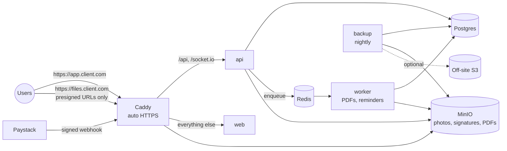

# Deploying a client

OpsDesk is a **single-business, white-label template**. Each client (a plumbing company, a cleaning firm…) gets their own deployment: their own server, database, files, domain and branding. This guide takes you from a blank VPS to a live, HTTPS-secured instance with nightly backups, in about 30 minutes.

**What you'll end up with on the server**



Only ports 80 and 443 are open to the internet. Postgres, Redis and MinIO are reachable only inside the Docker network.

---

## 1. Prepare the server (once per VPS)

**Size:** 2 vCPU / 4 GB RAM / 40 GB disk handles a typical service business (a few thousand jobs a year with photos). Any provider works (Hetzner, DigitalOcean, AWS Lightsail…). These steps assume **Ubuntu 24.04**.

```bash
ssh root@YOUR_SERVER_IP
```

```bash
apt-get update && apt-get -y upgrade && apt-get -y install git ufw openssl
```

```bash
curl -fsSL https://get.docker.com | sh
```

```bash
ufw allow OpenSSH && ufw allow 80/tcp && ufw allow 443/tcp && ufw allow 443/udp && ufw --force enable
```

Then get the code onto the server:

```bash
git clone https://github.com/YOUR_ORG/opsdesk.git /opt/opsdesk && cd /opt/opsdesk
```

> One client per server is the supported layout: Caddy binds ports 80/443, and each client's data stays physically separate. Running several clients on one machine would need a shared reverse proxy in front of the stacks; that's on the roadmap.

## 2. DNS

Create two records pointing at the server's IP. Do this first, because certificates can't be issued until they resolve:

| Record | Example                  | Used for                               |
| ------ | ------------------------ | -------------------------------------- |
| A/AAAA | `app.acme-plumbing.ng`   | The app (dashboard, API, live updates) |
| A/AAAA | `files.acme-plumbing.ng` | Photo/signature uploads and downloads  |

Check with `dig +short app.acme-plumbing.ng`. The deploy script warns if a name doesn't resolve yet.

## 3. Configure the client

```bash
cp -r clients/example clients/acme
```

```bash
mv clients/acme/.env.example clients/acme/.env
```

Then edit the two files:

**`clients/acme/client.config.ts`**: who the client is. It's typed, so your editor autocompletes and flags mistakes.

| Section    | What it controls                                                                                                                 |
| ---------- | -------------------------------------------------------------------------------------------------------------------------------- |
| `business` | Name, slug, contact details, **time zone** (IANA, e.g. `Africa/Lagos`), **currency** (ISO, e.g. `NGN`), locale, default tax rate |
| `branding` | App name, primary colour (text colour is picked automatically for contrast), logo, favicon, tagline                              |
| `features` | Which modules exist: `inventory`, `payments`, `bookingPortal`, `technicianApp`, `analytics`, `publicApi`                         |
| `payments` | Provider (`paystack` or `stripe`), required when `features.payments` is on                                                       |
| `owner`    | Name and email of the first account (created on first deploy)                                                                    |
| `domains`  | The app's hostname (the deployment's `APP_DOMAIN` overrides it, so they can't drift)                                             |

**`clients/acme/.env`**: the deployment: domains, the Let's Encrypt email, secrets and optional overrides. Leave secrets as `generate`; the deploy script fills them in.

Check the config before deploying. This needs Node locally; on the server, the Docker build runs the same check.

```bash
pnpm client:check acme
```

> `clients/*` is git-ignored except `clients/example`. A client's `.env` holds their secrets: back it up somewhere safe (a password manager or secrets vault). Without it you can't reconnect a restored server to its database and file storage. (Losing only `JWT_ACCESS_SECRET` is harmless: a new one just signs everyone out.)

### Feature toggles

A disabled feature isn't hidden behind an `if`: its server modules aren't loaded, so its endpoints return 404, its pages 404, and its navigation items disappear. Toggle in `client.config.ts`, or per environment in `.env`:

| Feature         | Env override             | What it adds                                      |
| --------------- | ------------------------ | ------------------------------------------------- |
| `inventory`     | `FEATURE_INVENTORY`      | Stock items, parts used on jobs, low-stock alerts |
| `payments`      | `FEATURE_PAYMENTS`       | "Pay now" on invoices (Paystack) + webhooks       |
| `bookingPortal` | `FEATURE_BOOKING_PORTAL` | Public booking page at `/book`                    |
| `technicianApp` | `FEATURE_TECHNICIAN_APP` | The offline-capable technician PWA                |
| `analytics`     | `FEATURE_ANALYTICS`      | Owner dashboard: revenue, utilisation, etc.       |
| `publicApi`     | `FEATURE_PUBLIC_API`     | API keys and outgoing webhooks                    |

Values must be exactly `true` or `false`; anything else stops the app from starting, with a message naming the variable.

### Online payments (Paystack)

Invoicing (quotes, invoices, PDFs, manual payments, overdue reminders) is always on. The `payments` feature adds a **Pay now** button to the customer's invoice link.

1. In the Paystack dashboard (Settings → API Keys & Webhooks), copy the **secret** key into `.env` as `PAYSTACK_SECRET_KEY` (`sk_test_…` while testing, `sk_live_…` to go live).
2. On the same page, set the **Webhook URL** to `https://<APP_DOMAIN>/api/webhooks/payments`.
3. Redeploy with `--skip-build`.

The deploy script refuses to start with `payments` on and no key. No Paystack account yet? Set `FEATURE_PAYMENTS=false`: invoices still go out with the business's contact details for a bank transfer, and staff record the payment by hand.

Payment safety, in short: webhooks are verified (HMAC-SHA512 over the raw body), recorded by event id in the same transaction as the payment (a retried or duplicated webhook is a no-op), and the amount must match exactly what was requested. When the customer returns from checkout, the API also asks Paystack directly, so the page shows "Paid" even if the webhook is late.

### Invoice settings

Optional `invoicing` block in `client.config.ts` (all have defaults):

| Setting                | Default | Meaning                                           |
| ---------------------- | ------- | ------------------------------------------------- |
| `paymentTermsDays`     | 14      | Due date = issue date + this                      |
| `quoteValidityDays`    | 30      | How long a quote is valid                         |
| `partsMarkupBps`       | 0       | Markup on parts when invoicing a job (2000 = 20%) |
| `reminderIntervalDays` | 3       | Days between overdue reminders                    |
| `maxReminders`         | 3       | Reminders per invoice (0 turns them off)          |
| `footer`               | none    | Printed on every PDF (e.g. bank details)          |

The default tax rate is `business.taxRateBps` (750 = 7.5% VAT).

### Booking page

With `bookingPortal` on, customers book at `https://<APP_DOMAIN>/book/<business.slug>` (link it from the client's website, Google Business profile or WhatsApp bio). Each booking becomes an unassigned job at the chosen time in the dispatch board's "to schedule" tray, and the office gets an email.

Optional `booking` block in `client.config.ts`:

| Setting         | Default                        | Meaning                                     |
| --------------- | ------------------------------ | ------------------------------------------- |
| `hours`         | Mon–Fri 08:00–18:00, Sat 09–14 | Opening hours per weekday (`null` = closed) |
| `slotMinutes`   | 60                             | Slot grid (15, 30, 60 or 120)               |
| `leadTimeHours` | 2                              | Earliest bookable time from now             |
| `horizonDays`   | 21                             | How far ahead customers can book            |

A slot is offered only if a technician is free for the whole job (service duration) and it isn't already held by another unassigned online booking. The check runs again under a lock on submit, so two people can't take the last slot. Bookings are limited to 5 per visitor IP per 10 minutes.

### Customer notifications

Customers hear about their booking, its confirmation (time + technician), "on the way", completion, cancellation, invoices and overdue reminders. Choose channels with the optional `notifications` block: `{ email: true, sms: false, whatsapp: false }` (defaults). Each message goes out on every enabled channel the customer has details for.

Every message is logged (job and invoice pages show a **Messages** card) and delivered by the worker with retries; a provider outage delays messages, it never fails a booking or a status change. The template includes console providers for SMS and WhatsApp: connecting a real gateway (Termii, Twilio, Meta's WhatsApp Cloud API) means binding one class to `SMS_PROVIDER` / `WHATSAPP_PROVIDER` in `notifications.module.ts`.

### Public API and webhooks

With `publicApi` on, the owner creates API keys (with scopes) and webhook endpoints under **Developers**, and the API reference is served at `https://<APP_DOMAIN>/api/docs`. Webhook signing secrets are encrypted with `DATA_ENCRYPTION_KEY`, which the deploy script generates on first run: **back it up with the database** (if it's lost, rotate each endpoint's secret). In production, webhooks only go to https URLs on public addresses.

Rate limits are per client IP (login, booking, checkout) and per API key, stored in Redis. If many staff share one office IP, raise them with `RATE_LIMIT_MULTIPLIER` (e.g. 3).

### Public demo deployments

**Serverless (Vercel), as the live demo does:** three Vercel projects with root directories `apps/api` (`apps/api/vercel.json`: one function + a daily cron), `apps/tech` and `apps/web`, plus Neon Postgres from the Vercel marketplace. API env: `SERVERLESS=true`, `DEMO_MODE=true`, `STORAGE_DRIVER=database`, `COOKIE_SECURE=true`, `JWT_ACCESS_SECRET`, `DATA_ENCRYPTION_KEY`, `CRON_SECRET`, `APP_URL`/`WEB_ORIGIN` (the web address). Web env: `API_URL`, `TECH_URL`, `NEXT_PUBLIC_REALTIME_URL=off`, `DEMO_LOGINS=true`. Technician app env: `API_URL`, `NEXT_PUBLIC_REALTIME_URL=off`. Run migrations, bootstrap and the seed once against the database's direct (unpooled) URL. Not for real clients: no live updates, objects in Postgres, and demo-only payments.

**On a server:**

A sales demo is a normal deployment with demo data and one-click sign-in: set `DEMO_LOGINS=true` (and the same value for `OWNER_INITIAL_PASSWORD` and `DEMO_PASSWORD`) and deploy with `--seed-demo`. Never set `DEMO_LOGINS` for a real client.

### Other overrides

Env always wins over the file, and the result is validated with the same schema:

| Env var                                               | Overrides                                           |
| ----------------------------------------------------- | --------------------------------------------------- |
| `CLIENT_BUSINESS_NAME`                                | `business.name`                                     |
| `CLIENT_BUSINESS_EMAIL`, `CLIENT_BUSINESS_PHONE`      | contact details                                     |
| `CLIENT_TIMEZONE`, `CLIENT_CURRENCY`, `CLIENT_LOCALE` | regional settings                                   |
| `CLIENT_APP_NAME`                                     | `branding.appName`                                  |
| `CLIENT_PRIMARY_COLOR`                                | `branding.primaryColor`                             |
| `CLIENT_LOGO_URL`                                     | `branding.logoUrl`                                  |
| `CLIENT_APP_DOMAIN`                                   | `domains.app` (set automatically from `APP_DOMAIN`) |

Overrides are applied at **runtime**: change `.env`, then re-run the deploy script with `--skip-build`. Edits to `client.config.ts` itself need a rebuild (just re-run the script).

## 4. Deploy

```bash
./scripts/deploy-client.sh acme
```

What it does, in order:

1. **Generates secrets** left as `generate` (database password, JWT secret, storage keys, owner password) with `openssl`, writes them to `.env`, and locks the file down (`chmod 600`). Existing secrets are never changed.
2. **Checks DNS** for both hostnames and warns about placeholders.
3. **Builds the images** with this client's config compiled in. An invalid config fails here, not in production.
4. **Starts Postgres, Redis and MinIO**, creates the private storage bucket.
5. **Validates the runtime config** (file plus env overrides) and prints the enabled features.
6. **Applies database migrations** (`prisma migrate deploy`: forward-only, never resets).
7. **Bootstraps the business**: creates the organization and the owner on first run; on later runs it syncs name, colour, currency and time zone from the config. It refuses to run if the database already belongs to a different business, which catches a pasted-wrong `DATABASE_URL`.
8. **Starts everything** and waits until health checks pass.

On the first deploy it prints the **owner's password once**, then removes it from `.env`. Store it in a password manager straight away.

**Updating a client** (new release, config change):

```bash
git pull && ./scripts/deploy-client.sh acme
```

The same script handles updates: rebuild, migrate, re-sync config, then recreate the containers (a few seconds of downtime; zero-downtime deploys are on the roadmap). Take a backup first if the release notes mention data migrations: `./scripts/backup-now.sh acme`.

### Seed data

| Command                                       | Use for                  | What you get                                                             |
| --------------------------------------------- | ------------------------ | ------------------------------------------------------------------------ |
| _(always)_ bootstrap                          | Every client             | The business and its owner, nothing else                                 |
| `./scripts/deploy-client.sh acme --seed-demo` | Sales demos, staging, QA | A dispatcher, two technicians, services, customers and jobs around today |

Demo staff use the owner's email domain (`dispatch@…`, `tech@…`, `tech2@…`) and the password in `DEMO_PASSWORD` (default `demo-password-123`). **Never seed demo data into a real client's instance.** It's real data as far as the app is concerned.

## 5. SSL

Nothing to do: **Caddy obtains and renews Let's Encrypt certificates automatically** for `APP_DOMAIN` and `FILES_DOMAIN` once DNS resolves and ports 80/443 are open. Expiry notices go to `ACME_EMAIL`. Certificates are stored in the `caddy_data` volume, so redeploys don't re-request them.

The site also sends HSTS, `nosniff` and a strict referrer policy, and the API's cookies are `Secure` + `HttpOnly`. Because the app, API and WebSockets share one origin, there's no CORS configuration to get wrong.

**If certificates fail:** `docker compose -p opsdesk-acme logs caddy`. The usual causes are DNS not pointing here yet, port 80 blocked (check the firewall and any cloud security group), or Let's Encrypt rate limits after many failed attempts. Fix the cause, wait for the limit to clear, and redeploy.

## 6. Backups

A `backup` container runs **every night at `BACKUP_HOUR`** (server time; set `TZ` in `.env`):

- **Database:** `pg_dump` in compressed custom format → `backups` volume, `/backups/db/opsdesk-acme-YYYYMMDD-HHMMSS.dump`. Written to a temp file and renamed, so a dump on disk is always complete.
- **Files:** photos and signatures are mirrored through the S3 API → `/backups/files` (incremental).
- **Retention:** dumps older than `BACKUP_RETENTION_DAYS` (default 14) are deleted.
- **Off-site (strongly recommended):** set `BACKUP_S3_BUCKET` (+ endpoint and keys) and each run is also copied to that bucket under `opsdesk-acme/`. Any S3-compatible service works (AWS S3, Backblaze B2, Wasabi, Cloudflare R2). Use a bucket with versioning or object lock if you can. Without it, the logs warn every night that backups live only on this server.

On demand, for example before an upgrade:

```bash
./scripts/backup-now.sh acme
```

### Restoring

```bash
./scripts/restore.sh acme opsdesk-acme-20261120-020000.dump
```

Add `--with-files` to restore photos and signatures too. The script asks you to type the client name, takes a **safety backup of the current state first**, stops the app, restores in a single transaction, re-applies migrations (in case the dump is older than the code), and starts the app again.

To restore from the **off-site** copy (e.g. the server is gone), deploy to a fresh server first, then copy the dump into the volume before running `restore.sh`:

```bash
docker compose -p opsdesk-acme -f infra/deploy/docker-compose.yml --env-file clients/acme/.env run --rm --entrypoint sh backup -c 'AWS_ACCESS_KEY_ID="$BACKUP_S3_ACCESS_KEY" AWS_SECRET_ACCESS_KEY="$BACKUP_S3_SECRET_KEY" aws ${BACKUP_S3_ENDPOINT:+--endpoint-url "$BACKUP_S3_ENDPOINT"} s3 sync "s3://$BACKUP_S3_BUCKET/opsdesk-acme/" /backups/'
```

**Test your restores.** A backup you've never restored is a hope, not a backup. Restore into a staging server quarterly.

Also back up, outside the server: `clients/acme/.env` (secrets) and `clients/acme/client.config.ts`.

## 7. Day-two operations

| Task                | Command                                                                                                                              |
| ------------------- | ------------------------------------------------------------------------------------------------------------------------------------ |
| Logs                | `docker compose -p opsdesk-acme logs -f api` (or `worker`, `web`, `caddy`, `backup`)                                                 |
| Status              | `docker compose -p opsdesk-acme ps`                                                                                                  |
| Restart the app     | `./scripts/deploy-client.sh acme --skip-build`                                                                                       |
| Effective config    | `docker compose -p opsdesk-acme -f infra/deploy/docker-compose.yml --env-file clients/acme/.env run --rm --no-deps api check-config` |
| Health              | `curl https://app.acme-plumbing.ng/api/health`                                                                                       |
| OS security updates | `apt-get install unattended-upgrades` (recommended)                                                                                  |

Set `SENTRY_DSN` in `.env` to report errors to Sentry.

## Troubleshooting

| Symptom                                   | Likely cause / fix                                                                                                                                            |
| ----------------------------------------- | ------------------------------------------------------------------------------------------------------------------------------------------------------------- |
| Build fails with "Invalid client config"  | The message lists each bad field. Fix `client.config.ts` and re-run `pnpm client:check <name>` locally.                                                       |
| App won't start: "must be true or false"  | A `FEATURE_*` override has a typo'd value.                                                                                                                    |
| `bootstrap failed: already belongs to …`  | This database belongs to another business. Check `DATABASE_URL`/`POSTGRES_PASSWORD` and the compose project name.                                             |
| `OWNER_INITIAL_PASSWORD … is required`    | The owner doesn't exist (fresh database) and the password was already consumed. Set a new one in `.env` and redeploy.                                         |
| Photo uploads fail                        | `FILES_DOMAIN` must resolve and have a certificate; check `docker compose -p opsdesk-acme logs caddy minio`.                                                  |
| Customers don't get messages              | Open the job's **Messages** card: "Retrying" or "Failed" shows the provider's error. Queued messages need the worker running.                                 |
| Booking page shows no times               | Check `booking.hours` (and the time zone), that at least one active technician exists, and services are active.                                               |
| Invoice PDF stuck on "Preparing…"         | The worker isn't running or can't reach Redis/MinIO: `docker compose -p opsdesk-acme logs worker`. Queued jobs run once it's back.                            |
| Paid on Paystack but invoice still unpaid | Webhook URL wrong or blocked. Check it in the Paystack dashboard (it shows delivery attempts) and `logs api`. A 401 there means the secret key doesn't match. |
| "Reconnecting…" badge in the app          | WebSockets blocked by an upstream proxy/CDN. With Cloudflare, enable WebSockets or use DNS-only mode.                                                         |
